# Cybersecurity Lab Setup – Networkwalks Internship (Task WK1-PM1)

**Author:** [Ahmed Hussien Hossam eldin]
**Internship:** Networkwalks Academy
**Task:** WK1-PM1 – Set up a Cybersecurity testing lab environment using VirtualBox and Kali Linux

---

## 1. Objective

Build an isolated cybersecurity practice lab on a personal laptop/PC using VirtualBox, with all virtual machines connected to one custom NAT Network (`10.0.0.0/24`).

## 2. Lab Architecture

| Machine | OS | IP Address | Network | Role |
|---|---|---|---|---|
| Kali Linux | Kali Linux 2026.3 (amd64) | `10.0.0.2/24` | NatNetwork | Attacker machine |
| Windows 10 VM | Windows 10 | `10.0.0.10/24` | NatNetwork | Target machine (optional) |
| Android VM | Android 9.x | `10.0.0.9/24` | NatNetwork | Target machine (optional) |

- **Hypervisor:** Oracle VirtualBox
- **Network:** NAT Network `NatNetwork`, IPv4 prefix `10.0.0.0/24`, DHCP enabled
- **Gateway:** `10.0.0.1`

## 3. Requirements Checklist

| Requirement | Status |
|---|---|
| VirtualBox installed | Done |
| NAT Network created in `10.0.0.0/24` | Done |
| Kali Linux imported and configured | Done |
| Kali static IP `10.0.0.2/24` | Done |
| Kali has full Internet access | Done |
| Shared folder enabled with the host machine | Done |
| Snapshot of the Kali VM | Done |
| Windows 10 VM on `10.0.0.10` (optional) | Done |
| Android VM on `10.0.0.9` (optional) | Done |

---

## 4. Implementation Steps

### Step 1 – Install VirtualBox

VirtualBox Manager installed on the host machine.

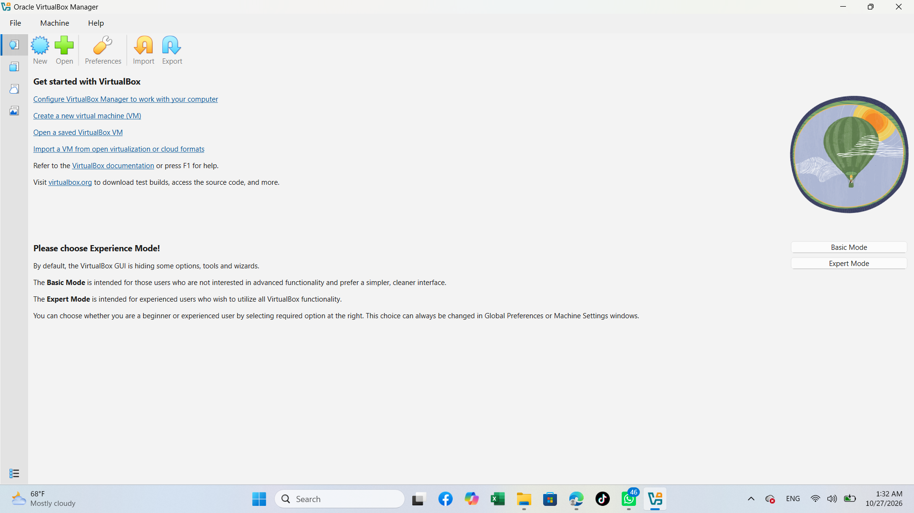

### Step 2 – Create the NAT Network (`10.0.0.0/24`)

`Tools > Network > NAT Networks > Create`
- Name: `NatNetwork`
- IPv4 Prefix: `10.0.0.0/24`
- DHCP: Enabled

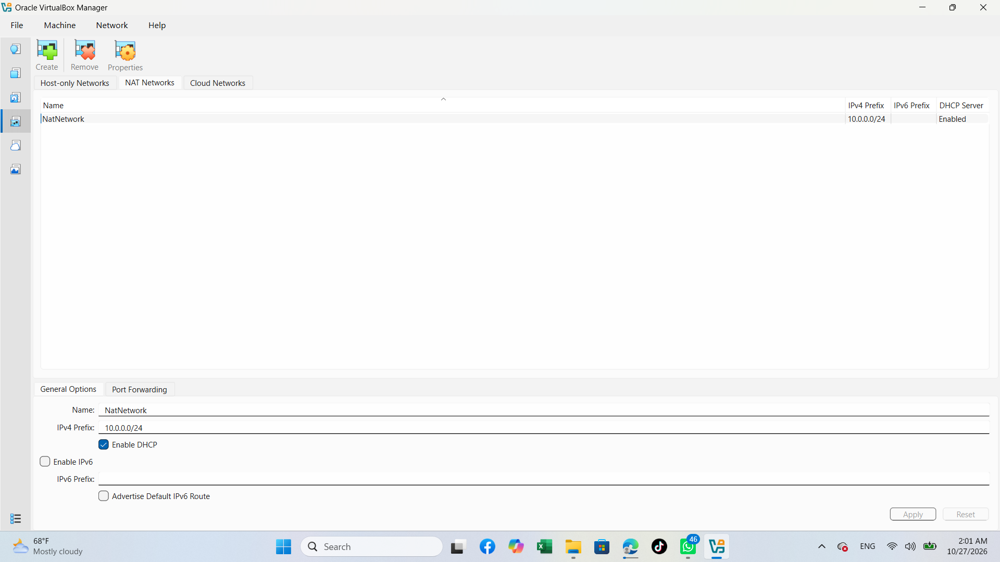

### Step 3 – Import Kali Linux and attach it to the NAT Network

Kali Linux (`kali-linux-2026.3-virtualbox-amd64`) imported into VirtualBox.
`Settings > Network > Adapter 1`
- Attached to: `NAT Network`
- Name: `NatNetwork`
- Adapter Type: Intel PRO/1000 MT Desktop (82540EM)
- Promiscuous Mode: Allow All

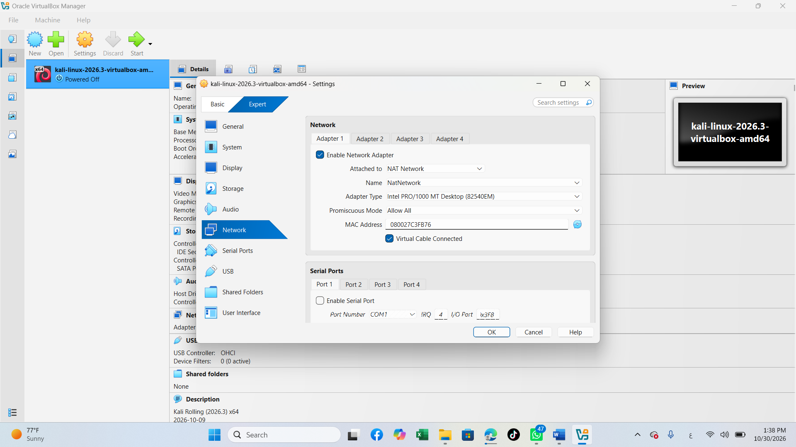

### Step 4 – Configure the static IP on Kali

`Edit Connections > Wired connection 1 > IPv4 Settings`
- Method: Manual
- Address: `10.0.0.2`
- Netmask: `24`
- Gateway: `10.0.0.1`
- DNS: `10.0.0.1`

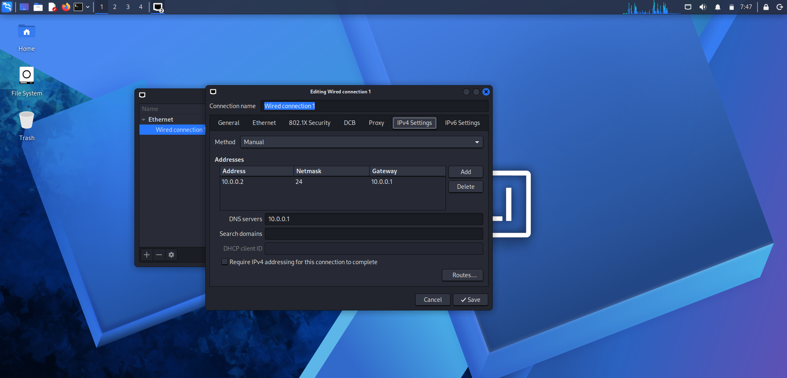

### Step 5 – Verify Internet access from Kali

Internet access confirmed from Firefox inside Kali.

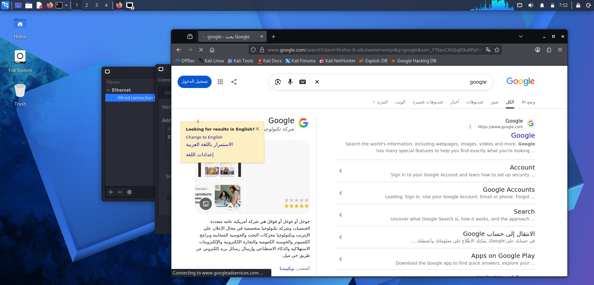
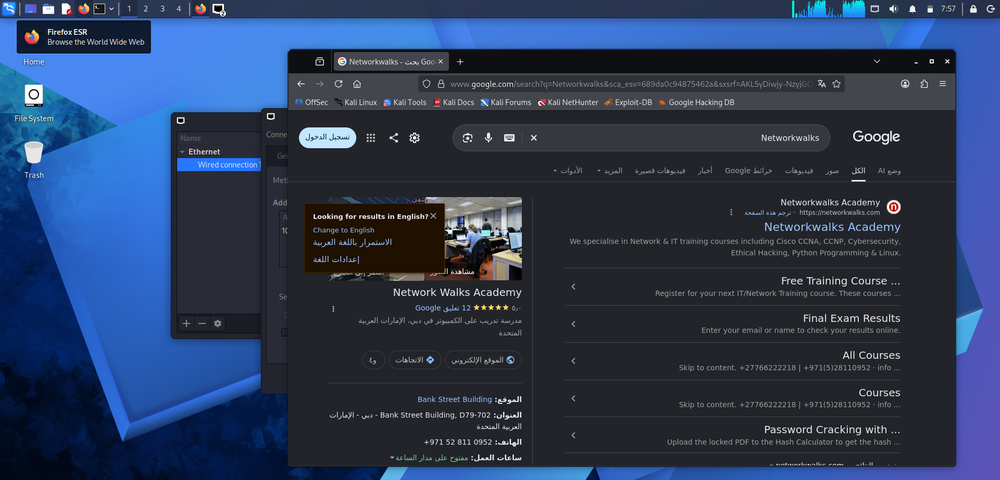

### Step 6 – Shared folder with the host

A host folder is shared with the VM (Full access, Auto Mount enabled).

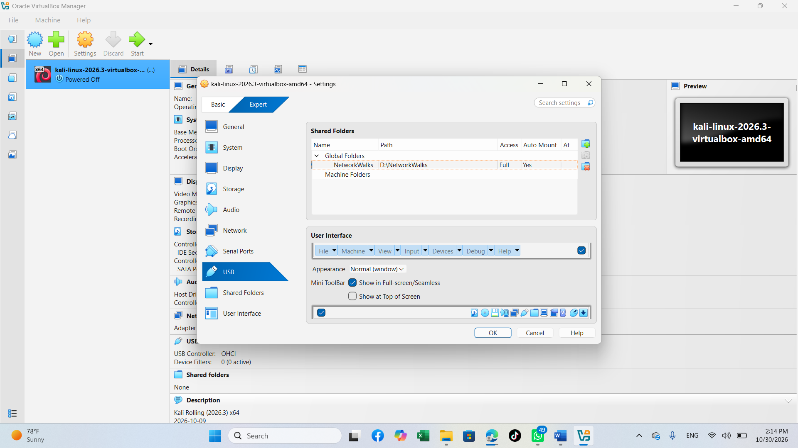

### Step 7 – Snapshot of the Kali VM

Snapshot `my fresh kali linux` taken after finishing the setup.

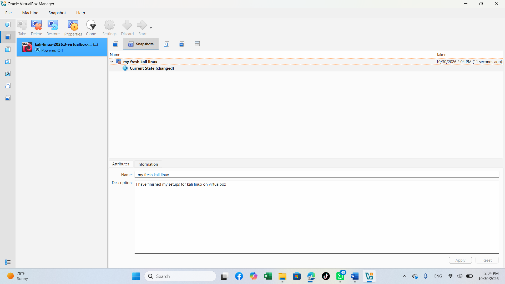

---

## 5. Phase 2 – Additional Machines (Optional)

### Windows 10 VM – `10.0.0.10`

`ipconfig` output confirms the IPv4 address `10.0.0.10`, mask `255.255.255.0`, gateway `10.0.0.1`, with working Internet access.

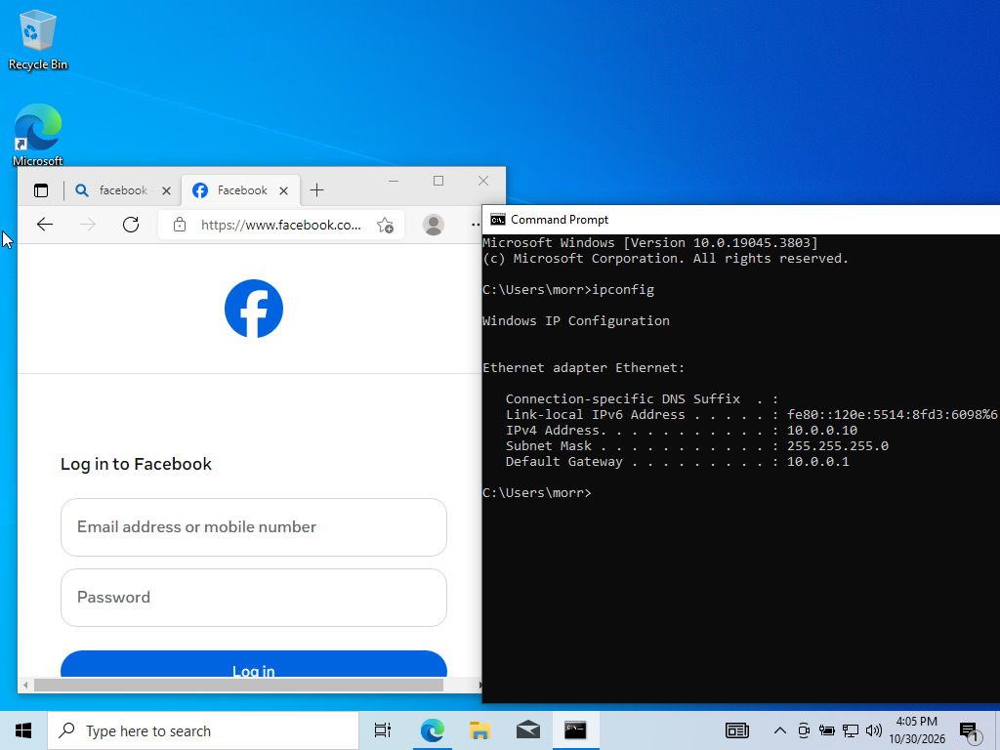
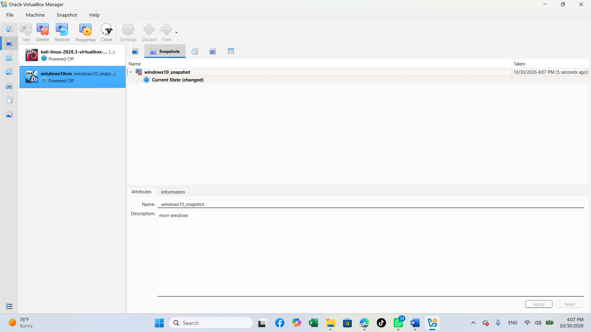

### Android VM – `10.0.0.9`

Android VM running on the same NAT Network with Internet access.


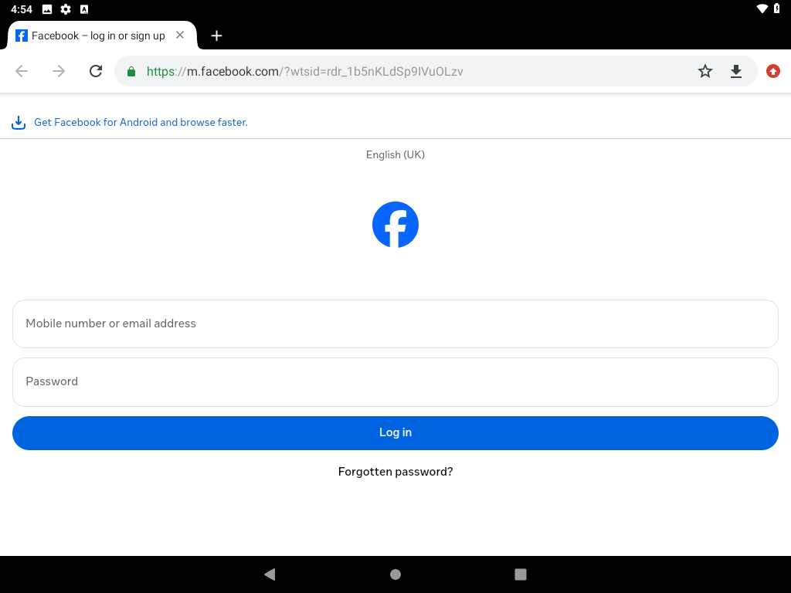
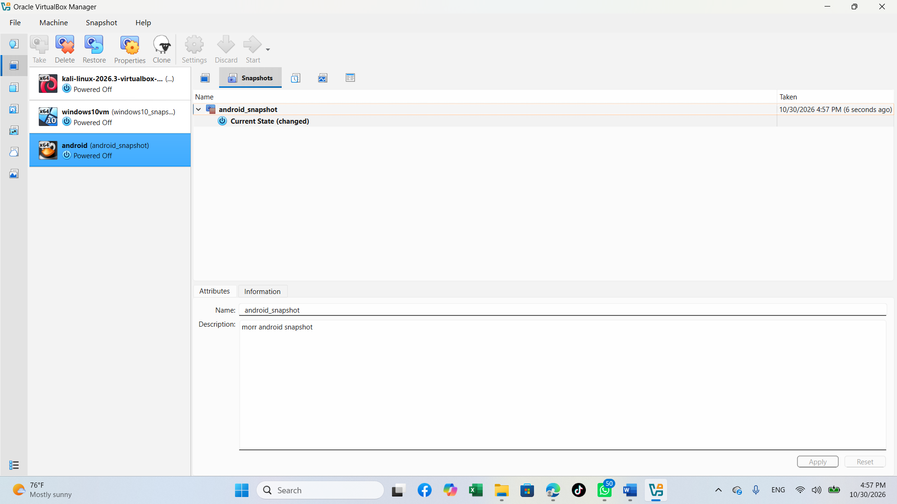

---

## 6. Troubleshooting Note

If Kali has no Internet in VirtualBox 7 / Kali 2026.1+, run:

```bash
sudo nmcli connection modify "Wired connection 1" ipv4.dad-timeout 0
sudo nmcli connection down "Wired connection 1"
sudo nmcli connection up "Wired connection 1"
```

## 7. Conclusion

All three VMs (Kali, Windows 10, Android) are on the same NAT Network with their own IPs and Internet access, and each one has a snapshot I can roll back to if something breaks during practice.

Next, I'll start using this lab for the upcoming tasks, using Kali as the attacker machine against the Windows 10 and Android VMs.
